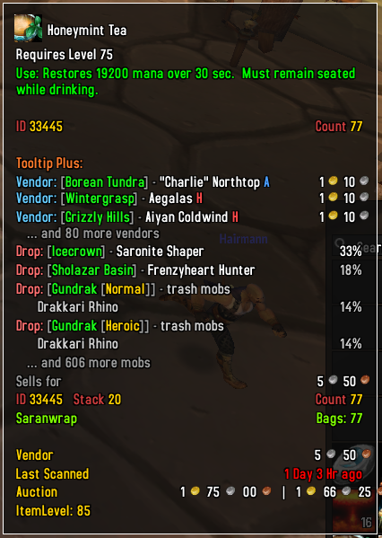
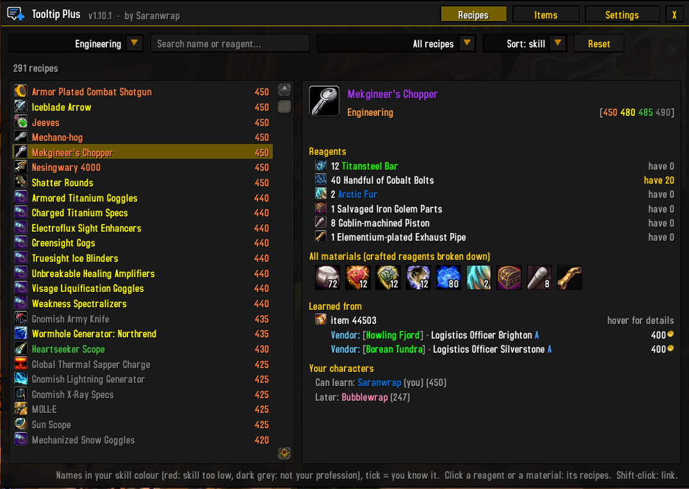
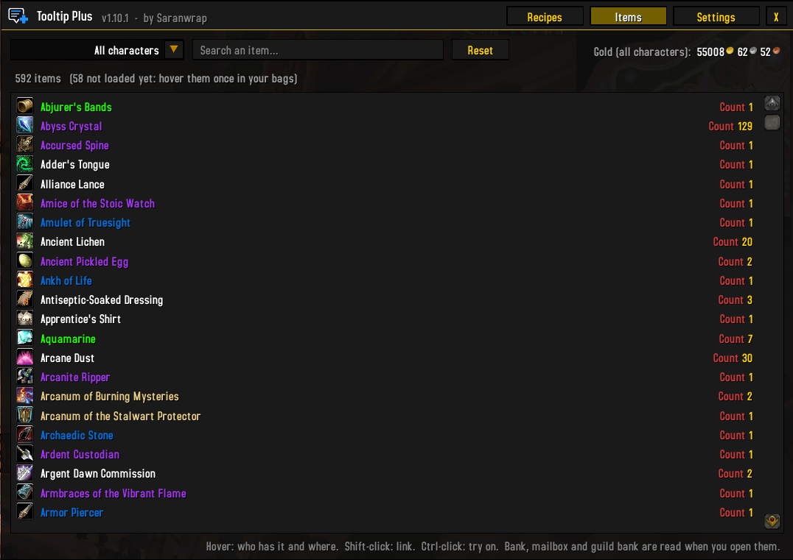
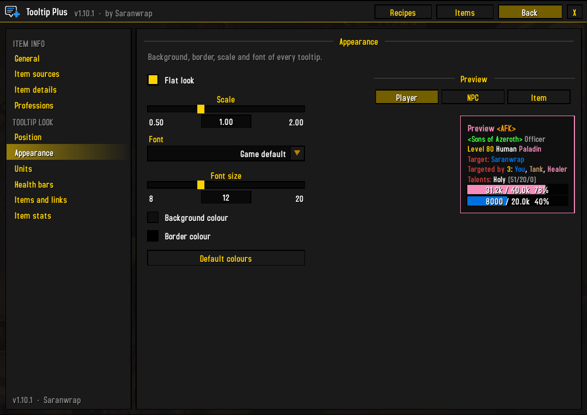
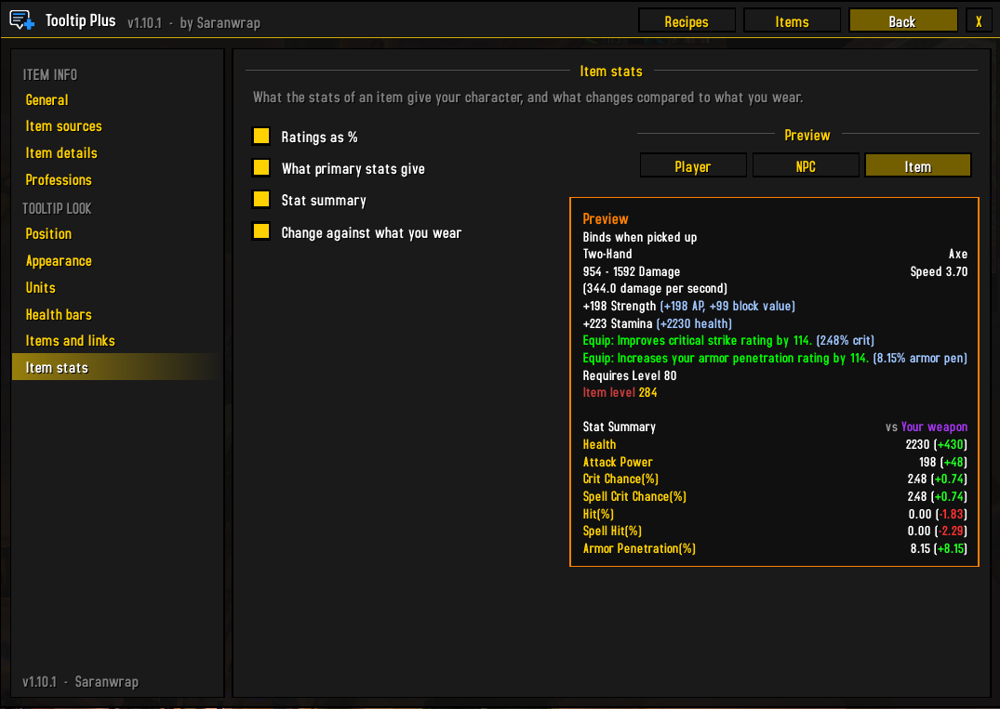
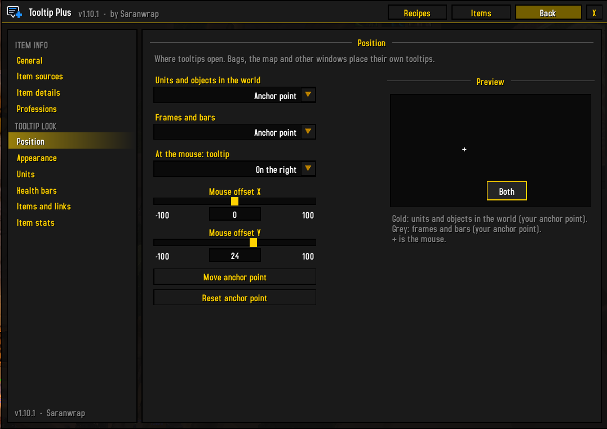

# Tooltip Plus

**Everything about an item, right in its tooltip.** For World of Warcraft 3.3.5a (Wrath of the Lich King).

Version 1.10.2 · by Saranwrap

Hover any item and Tooltip Plus tells you where it comes from, what it is used for and how many your characters have, without leaving the game.

- **Where to get it**: vendors, quest rewards, crafting, mob drops with the drop chance, chests and gathering nodes, containers, disenchanting, prospecting, milling, skinning, pickpocketing and fishing.
- **Professions**: which professions use a material, the reagents and skill colours of a crafted item, and which of your characters know a recipe or can learn it.
- **Your characters**: how many of the item each of your characters has, and where (bags, bank, equipped, mailbox, currencies), plus your guild banks.
- **Sell price, stack size, item ID and item level.**
- **Tooltip look**: position (game default, at the mouse, or a spot you choose), flat look, scale, font, colours, borders in class / reaction / item quality colour.
- **Units**: class colours, guild rank, level, target, who in your group targets it, talents of players, NPC ID, and health and mana bars in the tooltip.
- **Item stats**: ratings as % at your level, what primary stats give your class, and a stat summary with the change against the item you wear.
- **Links**: spell, quest and achievement IDs, and the icon beside links clicked in chat.
- **One window** (minimap button) with every recipe of every profession, and everything your characters own, both searchable.

---

## Installation

1. Close the game.
2. Download the zip (on GitHub: **Code → Download ZIP**) and open it.
3. Copy the **`TooltipPlus`** folder into `<WoW folder>\Interface\AddOns\`. Keep its name: the addon loads from it.
4. Start the game.

**Updating:** close the game, **delete the old `TooltipPlus` folder completely** (and any `Tooltip-Plus-main` folder from an older download, so only one copy is installed), then copy in the new one. Copying over the old folder can keep old files (images in particular), and the game only loads new files after a full restart, not after `/reload`.

---

## In the tooltip

The information has its own block at the bottom of the tooltip, under the heading **Tooltip Plus:**

| Line | What it shows |
| --- | --- |
| **Vendor** | Who sells it, where, Alliance / Horde only (A / H), the price in gold, badges, honor or arena points, limited stock |
| **Quest** | The quest that rewards it, its level and where it starts |
| **Crafted** | The profession, skill colours `[250 290 305 320]` (orange / yellow / green / grey), the reagents, and which of your characters know the recipe or can learn it |
| **Drop** | The mobs that drop it, the place and mode (Normal, Heroic, 10, 25, 10 HC, 25 HC) and the drop chance per kill. Bosses and rare mobs are coloured; dungeon and raid trash is grouped under `[Ulduar [25]] - trash mobs` |
| **Object** | Chests, caches, herbs, ore veins… and the chance per opening |
| **Contained in** | Bags, boxes and caches that contain it |
| **Disenchanting, Prospecting, Milling** | What it comes from, with the chance |
| **Skinning, Pickpocket, Fishing** | Mobs or fishing zones, with the chance |
| **Teaches** | On a recipe: what it teaches, and which of your characters know it, can learn it now, or later |
| **Used in** | On a material: the professions that use it (number of recipes) and which of your characters know a recipe that uses it |
| **Sells for** | The vendor price |
| **ID / Count** | The item ID, the stack size, and how many all your characters have, then one line per character: `Bags: 24` or `90 (Bags: 24, Bank: 66)` |

Lines look like `Object: [Ulduar [25]] - Rare Cache of Winter   18%`: the place and mode first, then the source.

Tags after a source:

- **(Hallow's End)**, **(Brewfest)**… only during that world event
- **(quest)**: drops only while you are on the quest
- **(hard mode)**: drops only in hard mode
- **A / H**: Alliance / Horde only

When an item has many sources, the main ones are listed first, followed by "… and N more". An empty line closes the block, so the lines of other addons stay apart.

---

## The window

Open it with the minimap button or `/tplus recipes`. Tabs in the title bar: **Recipes**, **Items** and **Settings**.

### Recipes

Every recipe of every profession.

- Filter by profession, search a recipe or reagent name (or shift-click an item into the search box), and show all recipes, the ones this character knows, can learn now, or later, the ones another character knows, or the ones none of your characters know.
- Recipe names are in this character's skill colour (red: skill too low, dark grey: not one of its professions). A tick marks the recipes it knows.
- The right side shows the skill colours, how many it makes, the reagents with how many you have, where the recipe is learned (trainer, with the profession, the recipe item and where to get it, a quest, or a discovery) and which of your characters know it or can learn it.
- Under the reagents, **all the raw materials** as icons: crafted reagents are broken down (bars to ore, bolts to cloth, inks to pigments), with how many you need and how many you have.
- Click a reagent or a material icon to see the recipes that use it (or make it).
- Hover a recipe or a reagent for its full tooltip. Shift-click links it in chat.

**Shift + right-click a material** in your bags, your bank, a chat link or the window: the window opens with every recipe that uses it, the ones you know first. A crafted item opens its recipe.

### Items

Everything your characters on this realm have, and your guild banks, in one list.

- Search by name and filter by character or guild bank.
- Hover an item to see who has it and where. Shift-click links it, Ctrl-click tries it on.
- The gold of all your characters is shown at the top right (hover it for each character).

---

## Your characters

Log on each character once so it is remembered. Some things are read when you open them:

- **Bank, mailbox, guild bank**: when you open them (each guild bank tab when you look at it).
- **Recipes known**: when the character opens each of its profession windows.

`/tplus forget <name>` removes a character you deleted. The minimap button tooltip shows the gold of every character.

---

## Settings

Open them with `/tplus`, a right-click on the minimap button, or **Escape → Interface → AddOns → Tooltip Plus**. Categories are in a side bar on the left; hover an option to see what it does.

**Item info**

| Category | Options |
| --- | --- |
| **General** | Show item sources, only while holding Shift (the tooltip shows a "Hold Shift" line and fills in as soon as you press Shift), minimap button, the commands |
| **Item sources** | Compact (hide zones), "… and N more" lines, which sources to show |
| **Item details** | Item ID, stack size, sell price, count of all your characters, one line per character |
| **Professions** | Used in, recipes known / can learn, reagents of crafted items, Shift + right-click to open recipes |

**Tooltip look** (`/tplus look`), with a live preview of a player, an NPC or an item

| Category | Options |
| --- | --- |
| **Position** | **Units and objects in the world** and **Frames and bars** (unit frames, action bars, anything that uses the game's default spot): game default, at the mouse, or your anchor point. At the mouse: which side, X / Y offset. **Move anchor point** shows a box to drag (right-click it when done); the tooltip grows away from the nearest screen corner. The preview shows where each kind of tooltip opens. |
| **Appearance** | Flat look, scale, font, font size, background colour (with opacity), border colour |
| **Units** | Player names in class colour, &lt;AFK&gt; / &lt;DND&gt;, guild with rank, coloured level, race and class (Elite / Rare / Boss), hide the faction and PvP lines, target of the unit, targeted by (your group), talents of players, NPC ID, border in class / reaction colour |
| **Health bars** | Health bar, mana / rage / energy bar, numbers on the bars |
| **Items and links** | Border in item quality colour, item level of gear, spell / quest / achievement IDs, icon beside links clicked in chat |
| **Item stats** | **Ratings as %** (e.g. +32 Critical Strike Rating *(0.70% crit)*), **what primary stats give** (Strength → attack power and block value, Agility → crit, armor and attack power, Stamina → health, Intellect → mana and spell crit), **stat summary** under gear (one line per stat as your class uses it: health, mana, mana regen, attack or spell power, armor, crit, hit, haste…), **change against what you wear** in brackets (gains in green, losses in red; rings, trinkets and one-hand weapons against both of yours) |

**Targeted by** shows how many of your party or raid target the unit, and who (up to 6 names). The game only tells it for your group, so it shows while you are in a party or raid.

**Item stats** use the rating formula of 3.3.5 for your level and class (paladins, death knights, shamans and druids get 30% more melee haste). Crit from agility and intellect is shown at level 80. The summary uses the base stats of the items, without gems and enchants. Item level is not added when the tooltip already shows one.

Talents show the main tree and the points, e.g. **Holy (51/20/0)**. They are read when you hover a player within inspect range (about 28 yards) and remembered for 5 minutes. The health of mobs outside your group is only known as a percentage on 3.3.5.

The **Escape → Interface → AddOns** page also has every command as a button: open the window, look up an item, and forget a character.

---

## Commands

| Command | |
| --- | --- |
| `/tplus` | Settings (`/tooltipplus` works too) |
| `/tplus look` | Tooltip look settings |
| `/tplus recipes` | Recipes |
| `/tplus items` | Items of your characters |
| `/tplus gold` | Gold of your characters, in chat |
| `/tplus on` / `off` | Turn the item sources on or off |
| `/tplus <item ID>` | Print an item's sources in chat |
| `/tplus minimap` | Show or hide the minimap button |
| `/tplus chars` | Characters remembered on this realm |
| `/tplus forget <name>` | Forget a deleted character |
| `/tplus help` | List the commands |

---

## About the data

Sources, prices and drop chances come from the AzerothCore world database (the core ChromieCraft runs on) and the 3.3.5a game files. A server can change some of its data, so treat the drop chances as a guide.

---

## Screenshots

<b>Item tooltip</b>

<b>Recipes: reagents, all the materials broken down, where to learn it, who can learn it</b>

<b>Items on all your characters</b>

<b>Settings: tooltip appearance, with a live preview</b>

<b>Settings: item stats and the stat summary</b>

<b>Settings: tooltip position</b>

